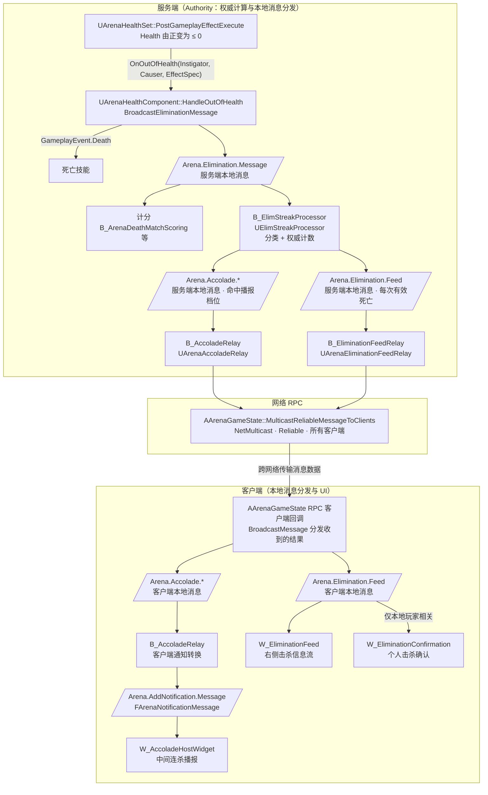
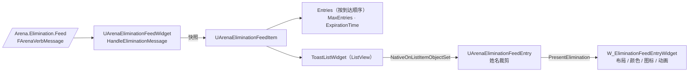
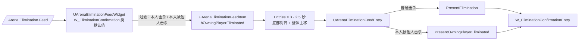

# 击杀信息展示：击杀信息流、连杀播报与个人击杀确认

本文是击杀后信息展示的唯一维护文档。内容从 `UArenaHealthSet` 生命值归零开始，说明服务端怎样构建击杀信息，
以及三个展示系统各自怎样把数据整理给 UI：

- **击杀信息流**（Elimination Feed）：屏幕右侧，所有玩家都能看到的全局击杀列表。
- **连杀播报**（Accolade）：屏幕中间的 Double Kill 等播报，所有玩家都能看到，播报上显示击杀者姓名。
- **个人击杀确认**（Elimination Confirmation）：准星下方，本地玩家击杀或被击杀时的单行提示。

准星上的命中/击杀反馈走 `ClientNotifyEnemyHit`，是独立链路，不在本文范围，见 `Docs/HitFeedback.md`。

全文按服务端负责权威计算、客户端负责 UI 展示来组织。`UGameplayMessageSubsystem::BroadcastMessage`
只通知当前运行实例内的监听者；跨网络传输由 RPC 完成。客户端收到 RPC 后，把传来的结果分发给自己的本地监听者，
不重新计算击杀或连杀。

## 1. 总体数据流

三个系统共用同一个服务端起点（`Arena.Elimination.Message`）、同一份连杀计数（`UElimStreakProcessor`）和同一条网络通道，
客户端按消息标签将收到的数据交给各自的本地监听者：

| | 击杀信息流 | 个人击杀确认 | 中间连杀播报 |
| --- | --- | --- | --- |
| 服务端本地消息 | `Arena.Elimination.Feed` | 与信息流相同 | `Arena.Accolade.*` |
| 网络通道 | GameState `NetMulticast, Reliable` | 与信息流相同，不新增 RPC | 与信息流相同 |
| 接收者 | 所有客户端 | 所有客户端收到，控件只保留本地玩家相关条目 | 所有客户端 |
| 客户端本地消息 | `Arena.Elimination.Feed`（`FArenaVerbMessage`） | 同左 | `Arena.AddNotification.Message`（`FArenaNotificationMessage`） |
| C++ 父类 | `UArenaEliminationFeedWidget` + `UArenaEliminationFeedEntry` | 同左（类默认值不同） | `UArenaAccoladeHostWidget` |
| UI 数据单元 | `UArenaEliminationFeedItem` | 同左 | `FPendingAccoladeEntry`（含 `FArenaAccoladeDefinitionRow`） |
| 触发条件 | 每次被击杀者可解析为 PlayerState 的死亡 | 本地玩家造成的击杀（敌人、队友、自己），或本地玩家被他人击杀 | 计数命中处理器配置的档位 |

播报和信息流走同一个 Actor 上的可靠多播，连接有效期间，同一 Actor 的可靠 RPC 按发送顺序传递。
当一次击杀命中播报档位时，处理器先发播报、后发信息流，因此客户端先接收播报消息，再接收信息流消息。
两个 UI 各自处理资源加载和排队，实际开始显示的时刻由各自控件决定。

## 2. 公共起点：构建权威击杀信息

### 2.1 生命值归零判定

1. 伤害 GE 在服务端执行。`UArenaHealthSet::PostGameplayEffectExecute` 把 `Damage` 换算为扣血后，
   若 `Health <= 0` 且此前 `bOutOfHealth` 为 false，广播
   `OnOutOfHealth(Instigator, Causer, &EffectSpec, Magnitude, OldValue, NewValue)`。
   `Instigator` 取自 `EffectContext.GetOriginalInstigator()`，`Causer` 取自 `GetEffectCauser()`。
2. 随后 `bOutOfHealth = (Health <= 0)`，保证死后的追加伤害不会重复产生击杀。
3. 客户端 `OnRep_Health` 也会广播 `OnOutOfHealth`，但 `EffectSpec` 为空。

### 2.2 `UArenaHealthComponent` 生成原始消息

`HandleOutOfHealth` 只在 `EffectSpec` 非空时（即服务端）处理，因此击杀消息只在服务端产生：

1. 通过 ASC 发送 `GameplayEvent.Death`，驱动死亡技能。
2. `BroadcastEliminationMessage` 在本地 `UGameplayMessageSubsystem` 上广播 `Arena.Elimination.Message`。

消息类型为 `FArenaVerbMessage`（“Instigator 对 Target 执行 Verb，带 Context 与 Magnitude”）：

| 字段 | 值 |
| --- | --- |
| `Verb` | `Arena.Elimination.Message` |
| `Instigator` | 伤害的 OriginalInstigator（可能是 PlayerState / Pawn / Controller，环境伤害为空） |
| `Target` | 被击杀者 Avatar 解析出的 PlayerState |
| `InstigatorTags` / `TargetTags` | EffectSpec 捕获的来源/目标标签 |
| `ContextTags` | `Gameplay.Damage.SelfDestruct`（Instigator 与 Target 相同）、`Gameplay.Damage.FromAlly`（同队）或 `Gameplay.Damage.FromEnemy`（异队，以及无法比较队伍的情况） |
| `ContextObject` | 手雷击杀时为 `UArenaGrenadeDefinitionData`，否则为空（见 2.3） |
| `Magnitude` | 默认值 1，未使用 |

这是服务端内部消息，不直接复制；计分等其他系统也监听它。客户端上不存在该消息，新增客户端监听时不要监听它。

### 2.3 手雷击杀归因（`ContextObject`）

- `AArenaGrenadeBase` 造成伤害时把投掷手雷的 `UArenaGrenadeDefinitionData` 写入 EffectContext 的 SourceObject。
  子弹药（`SecondaryGrenadesToSpawn`）和手雷生成的效果 Actor（含 `AArenaGroundAreaEffect`）继承最初投掷的定义，
  因此集束、燃烧区域等击杀记在玩家选择的手雷上，而不是内部子弹药定义。
- `FindSourceGrenadeDefinition` 解析该来源：SourceObject 为手雷定义则直接使用，为 `AArenaEffectActor` 则读取其
  `GetSourceGrenadeDefinition()`。
- 保留手雷定义资产引用作为归因信息，不传递手雷 Actor。经 RPC 发送的是 NetGUID 和首次映射所需的资产路径，
  不会逐字段发送定义中的伤害、特效、音效或子弹药配置；客户端通过本地资产解析引用，不依赖已销毁的手雷 Actor。
  资产及其硬引用依赖的本地加载成本与消息带宽是两个独立问题。当前信息流 WBP 的图标仍按击杀分类选择，
  `GrenadeDefinition` 作为可选归因数据保留，后续需要按手雷类型显示时可读取。
- 未覆盖：效果 Actor 被销毁后才结算的持续伤害（SourceObject 为弱引用），以及蓝图重写的 `SpawnSecondaryGrenade` /
  `SpawnEffectActor` 未调用 C++ 传递时，会退回为空或子弹药自身定义。

### 2.4 `UElimStreakProcessor`：分类与权威计数

`B_ArenaGameState` 上挂着以下 `UGameplayMessageProcessor` 组件（`BeginPlay` 时 `StartListening`，`EndPlay` 时注销）：

| 组件 | C++ 父类 | 监听范围 | 作用 |
| --- | --- | --- | --- |
| `B_ElimStreakProcessor` | `UElimStreakProcessor` | 仅 Authority | 计数，派生播报与信息流消息 |
| `B_EliminationFeedRelay` | `UArenaEliminationFeedRelay` | 仅 Authority | 信息流 RPC 转发 |
| `B_AccoladeRelay` | `UArenaAccoladeRelay`（蓝图无逻辑） | 服务端与客户端 | 播报多播转发与通知转换 |
| `B_ArenaDeathMatchScoring` | — | — | 计分，不在本文范围 |

`OnEliminationMessage` 先把 `Instigator`、`Target` 统一解析为 PlayerState（`UArenaVerbMessageHelpers::GetPlayerStateFromObject`），
再用 `UArenaTeamSubsystem::CompareTeams` 分类。三份历史以攻击者 PlayerState 为键，保存在处理器的 Transient 成员中：

| 分类 | 条件 | 历史 | 封顶 | 死亡是否清零 |
| --- | --- | --- | --- | --- |
| 自杀 | 攻击者 == 被击杀者 | `PlayerSelfElimHistory` | 10 | 否（本局累计） |
| 敌人击杀 | 攻击者存在、不同人且 `DifferentTeams` | `PlayerEnemyElimHistory` | 6 | 是 |
| 友军击杀 | `OnSameTeam` | `PlayerFriendlyElimHistory` | 30 | 否（本局累计） |

处理顺序：

1. 若存在攻击者，对应历史 +1 并封顶；若新计数在该分类的档位表（`EnemyElimStreakTags`、`SelfElimStreakTags`、
   `FriendlyElimStreakTags`）中，立即广播一条 `Arena.Accolade.*` 播报消息。
2. 若存在被击杀者，从敌人连杀历史中移除被击杀者（任何死亡都会清零其敌人连杀，包括自杀）。
3. 按本次分类读出当前计数，复制原消息改写为 `Arena.Elimination.Feed` 广播。

两条派生消息的字段：

| 字段 | `Arena.Accolade.*`（播报） | `Arena.Elimination.Feed`（信息流 / 个人确认） |
| --- | --- | --- |
| `Verb` | 档位表中配置的标签，如 `Arena.Accolade.EliminationStreak.3` | `Arena.Elimination.Feed` |
| `Instigator` | 攻击者 PlayerState | 攻击者 PlayerState（原始值可能是客户端无法解析的 Controller 或已销毁的 Pawn） |
| `Target` | 空 | 被击杀者 PlayerState |
| `InstigatorTags` / `ContextTags` | 复制自原始消息 | 复制自原始消息 |
| `TargetTags` / `ContextObject` | 空 | 复制自原始消息 |
| `Magnitude` | 本分类新计数 | 本分类当前计数，环境死亡为 0 |

边界情况：

- 攻击者为空（环境死亡）：不计数、不播报，信息流计数为 0。
- 被击杀者无法解析为 PlayerState：队伍比较为 `InvalidArgument`，既不计数也不产生信息流消息。
- 任一方没有队伍（`InvalidArgument`）：不计数、不播报；但原始消息已带 `FromEnemy`，信息流仍按敌人击杀显示，计数为 0。
- 连杀历史保存在 GameState 组件中，随 GameState 重建（如回合无缝切换后）而清空。

客户端不自行累计计数，三个系统显示的数字都来自这一份权威历史。

### 2.5 网络分发：服务端本地消息 → RPC → 客户端本地消息

两端出现同名消息，是因为服务端和客户端各有自己的 `UGameplayMessageSubsystem`。
本地 `BroadcastMessage` 只通知本端订阅者，不自动发送网络数据；RPC 把结果传到客户端后，还需要一次客户端本地分发才能通知 UI。

| 阶段 | 执行方 | 行为 |
| --- | --- | --- |
| 生成结果并通知转发器 | 服务端 | 连杀处理器广播本地 `Arena.Elimination.Feed` 或 `Arena.Accolade.*`，由对应 Relay 接收 |
| 网络传输 | 服务端 → 客户端 | Relay 调用 GameState 的 `MulticastReliableMessageToClients`，通过可靠 RPC 发送同一份消息数据 |
| 通知本地 UI | 客户端 | GameState 的 RPC 客户端回调调用 `BroadcastMessage(Message.Verb, Message)`，把收到的数据交给客户端监听者 |

**信息流与个人击杀确认**：服务端的 `UArenaEliminationFeedRelay` 监听 `Arena.Elimination.Feed` 并调用多播 RPC。
客户端收到 RPC 后，在自己的消息子系统中分发 `Arena.Elimination.Feed`；信息流控件与个人确认控件分别接收，
各自执行快照、过滤与显示逻辑，个人确认不额外发送网络消息。

**连杀播报**：`UArenaAccoladeRelay` 在服务端与客户端分别实例化，均以 `PartialMatch` 监听本端的 `Arena.Accolade`：

- **服务端实例**：收到连杀处理器的本地消息，调用 `MulticastReliableMessageToClients(Message)`，发给所有客户端。
- **客户端实例**：收到 GameState RPC 回调分发的本地消息，转换为 `FArenaNotificationMessage`，
  再分发到本地 `Arena.AddNotification.Message`，供播报 Host 控件消费（见 4.1）。

Relay 重复 `StartListening` 会先注销旧监听。网络转发只在 Authority 路径执行，客户端的本地分发不会再次发送 RPC，
因此不会形成循环。服务端只计算一次权威结果，每个客户端收到结果后只完成本地展示。

`FArenaVerbMessage` 作为 RPC 参数复制时，对象字段按 NetGUID 解析：`Instigator`、`Target` 是已复制的 PlayerState，
`ContextObject` 是资产。新增对象字段时必须可网络寻址（已复制的 Actor 或资产），否则客户端得到空指针。

`AArenaPlayerState::ClientBroadcastMessage`（`Client, Unreliable`）仍保留，但播报不再使用它。

## 3. 击杀信息流

### 3.1 数据组织

客户端的 `W_EliminationFeed`（`UArenaEliminationFeedWidget`）在 `NativeConstruct` 中监听本地 `Arena.Elimination.Feed`，
收到 RPC 回调分发的消息后，将其转换为一份不可变的显示快照 `UArenaEliminationFeedItem`：

| 快照字段 | 来源 | 说明 |
| --- | --- | --- |
| `VictimName` / `VictimTeamId` | `Target` → PlayerState | `Target` 无效时丢弃整条消息 |
| `AttackerName` / `AttackerTeamId` | `Instigator` → PlayerState | 攻击者为空时姓名为本地化的 `Environment` |
| `EliminationType` | 攻击者 == 被击杀者或 `SelfDestruct` → `Self`；`FromAlly` → `Ally`；`FromEnemy` → `Enemy` | 无标签时保持默认 `Self`（沿用自毁图标） |
| `EliminationStreak` | `Magnitude` 截到 0～99 | 字段名保持不变以兼容蓝图，含义是本分类的权威计数 |
| `GrenadeDefinition` | `ContextObject` 中的 `UArenaGrenadeDefinitionData` | 其他类型的上下文对象被忽略，非手雷伤害为空 |
| `bOwningPlayerEliminated` | 攻击者有效、不是本人，且被击杀者是本控件的本地玩家 | 信息流行不区分，个人击杀确认使用（见第 5 节） |
| `ExpirationTime` | 当前游戏时间 + `EntryLifetime` | 不暴露给蓝图 |

队伍直接从 PlayerState 查询（`UArenaTeamSubsystem::FindTeamFromObject`），不依赖死亡后可能已失效的 Pawn。
快照在接收时生成，之后改名、重生、离线都不影响已显示的条目。

### 3.2 列表管理

- 快照追加到 `Entries` 与 `ToastListWidget`，超过 `MaxEntries`（默认 8，运行时至少 1）时移除最早一条。
- 只调度一个计时器，指向最早的绝对到期时间（默认 6 游戏秒，非法值回退为 6 秒）；到期移除后重新调度。
  列表数据由控件统一删除，可复用的行控件不删除数据，移除最早条目不会提前删除后来条目。
- 条目数变化时调用蓝图事件 `OnFeedEntriesChanged(bHasEntries)`，WBP 据此切换容器可见性。
- 控件销毁或重建会清空列表、计时器和旧监听。
- 修改 `EntryLifetime` 时需同步调整条目 WBP 的 `IntroWithTimedOutro` 动画。

### 3.3 行控件与表现

`W_EliminationFeedEntryWidget` 继承 `UArenaEliminationFeedEntry`，通过原生 `IUserObjectListEntry` 接收快照：

1. `NativeOnListItemObjectSet` 先调用 `ResetEliminationPresentation` 停止旧动画（行控件复用或释放时同样调用）。
2. 按 `MaxNameLength`（默认 12，可在条目 WBP 类默认值修改）裁剪姓名：按 Unicode 码点计数、不拆分代理对，
   超出部分以“…”结尾；快照本身仍保存完整姓名。
3. 调用蓝图事件 `PresentElimination(AttackerName, VictimName, AttackerTeamId, VictimTeamId, EliminationType, EliminationStreak)`。
   `GrenadeDefinition` 不在参数中，WBP 通过列表项对象读取，用于决定图标或名称。

WBP 中的表现约定（布局、颜色、材质、图标、动画和插值都在 WBP，C++ 不参与）：

- 行布局为 `| [计数图标 ×N |] 攻击者 [类型图标] 被击杀者`，整行按内容宽度右对齐，姓名不设像素宽度上限。
- 左侧竖条按分类着色，姓名按队伍着色；自杀行与环境死亡只显示被淘汰者姓名、自杀图标和“自毁”。
- 计数区（勋章图标、×N、分隔线）在计数至少为 2 时显示，否则整体折叠；图标随计数档位切换对应勋章贴图，
  达到上限显示 `6+` / `30+` / `10+`。
- 计数图标、×N 与自杀图标使用触发者的队伍色（自杀的触发者即被淘汰者），通过 `M_UI_EliminationFeed_IconTint`
  的动态材质参数 `Icon` / `Tint` 设置。
- `WBP_CharacterOverlay` 中信息流宽 800 px，可容纳上限内最宽字形（双方 12 个 W/M 加 6+ 计数，约 755 px）；
  调大 `MaxNameLength` 时需同步加宽该容器。
- 测试依赖的控件名 `AttackerName`、`WeaponIconSwitcher`、`EnemyKill`、`StreakBadge`、`StreakText` 保持不变。

旧蓝图结构 `EliminationFeedMessage`、对象 `ElimFeedEntry` 和标签 `Arena.AddNotification.Killfeed`
不再参与运行时链路，保留仅为兼容历史引用。

## 4. 连杀播报 Accolade

### 4.1 数据组织

```mermaid
flowchart LR
    V[/"Arena.Accolade.*<br/>客户端本地 FArenaVerbMessage"/] --> AR["UArenaAccoladeRelay<br/>客户端实例"]
    AR --> N[/"FArenaNotificationMessage<br/>TargetChannel / PayloadTag / TargetPlayer"/]
    N --> H["UArenaAccoladeHostWidget"]
    H -- "DataRegistry: Accolades / PayloadTag" --> Row["FArenaAccoladeDefinitionRow<br/>DT_Accolades"]
    Row -- "异步加载 Sound / Icon" --> P["FPendingAccoladeEntry"]
    P --> Q["PendingAccoladeLoads → PendingAccoladeDisplays"]
    Q -- "CreateAccoladeWidget" --> T["W_AccoladeToast"]
```

播报的数据组织与信息流不同：**计数编码在标签里，而不是数值里**。处理器按档位表把计数映射为标签，
UI 用标签查表得到文案、图标、音效和时长，`Magnitude` 在客户端不再使用。

客户端的 `UArenaAccoladeRelay` 构造以下本地通知：

| 字段 | 值 |
| --- | --- |
| `TargetChannel` | `Arena.Accolade` |
| `PayloadTag` | 播报标签（即 `Verb`） |
| `TargetPlayer` | 击杀者 PlayerState，用于姓名快照和同玩家播报互斥，不用于筛选接收者 |
| `PayloadMessage` / `PayloadObject` | 未使用 |

### 4.2 档位配置

`B_ElimStreakProcessor` 当前配置的档位（标签前缀均为 `Arena.Accolade.`）：

| 分类 | 计数 → 标签 |
| --- | --- |
| 敌人 | 2 → `EliminationStreak.2`，3 → `.3`，4 → `.4`，5 → `.5`，6 → `.5+` |
| 自杀 | 1 → `SelfKillStreak.1`，2 → `.2`，3 → `.3` |
| 友军 | 1 → `FriendlyKillStreak.1`，3 → `.3`，5 → `.5`，10 → `.10`，20 → `.20` |

敌人计数封顶为 6，因此第 6 次及之后每次敌人击杀都会再次触发 `.5+`；自杀超过 3、友军超过 20 后不再触发。
`DefaultGameplayTags.ini` 中的 `FriendlyKillStreak.30` 目前未配置到档位表，`DT_Accolades` 也没有对应行。

### 4.3 查表行 `FArenaAccoladeDefinitionRow`

`AccoladeDataRegistry` 的数据源为 `DT_Accolades`，行名即播报标签全名；`DefaultGame.ini` 的 `DataRegistrySettings`
扫描 `/Game/Blueprints/Accolades` 注册该 Registry。

| 行字段 | 用途 |
| --- | --- |
| `DisplayName` | 播报文案 |
| `Sound` / `Icon` | 软引用，Host 异步加载后写入 `FPendingAccoladeEntry` |
| `DisplayDuration` | 显示时长（秒），驱动 Host 的计时器 |
| `LocationTag` | 只有与 Host 的 `LocationName` 相同的行才显示 |
| `AccoladeTags` / `CancelAccoladesWithTag` | 互斥：新条目取消队列中带指定标签的旧条目（如三杀顶掉双杀） |

`DT_Accolades` 的当前内容：

| 行 | 文案 | 图标（`/Game/UI/Hud/Art/AccoladesTron/`） |
| --- | --- | --- |
| `EliminationStreak.2`～`.5` | Double / Triple / Quadra / Penta Kill | `T_UI_Icon_Accolade_Tron_DoubleKill` 等 |
| `EliminationStreak.5+` | Multi Kill | `T_UI_Icon_Accolade_Tron_MultiKill` |
| `FriendlyKillStreak.1/3/5/10/20` | Killed a teammate … Killed twenty teammates | `T_UI_Icon_Accolade_Tron_FriendlyKill*` |
| `SelfKillStreak.1/2/3` | — | `T_UI_Icon_Accolade_Tron_SelfKill*` |

敌人连杀行引用 `/Game/Audio/ParagonMaleAnnouncer` 下的 DoubleKill、TripleKill、QuadraKill、PentaKill、EpicKillingSpree 语音。

### 4.4 Host 的处理流程

`W_AccoladeHostWidget`（`UArenaAccoladeHostWidget`）在 `NativeConstruct` 中监听 `Arena.AddNotification.Message`：

1. **过滤**：只处理 `TargetChannel == Arena.Accolade` 的通知。`TargetPlayer` 非空时只检查控件有无 OwningPlayer，
   不比对是否为本地玩家，因此每个玩家都会显示所有人的播报。若以后要改为只给击杀者显示，
   在这里比对 `GetOwningPlayerState()` 与 `TargetPlayer` 即可，不需要改网络通道。
2. **分配序号并查表**：分配递增的 `SequenceID`，以 `FDataRegistryId("Accolades", PayloadTag)` 异步获取行，
   查表前先在 `PendingAccoladeLoads` 预留条目，同时快照 `TargetPlayerName` 和玩家的弱引用身份。
   立即请求失败或异步回调拿不到行时，记录 `LogArena` 警告并把条目标记为已完成且失败；序号不回收复用。
3. **加载资源**：查表成功后填写 `FPendingAccoladeEntry.Row`，异步加载非空的 `Sound` 和 `Icon`，
   完成后写入条目并标记 `bFinishedLoading`；两者均未配置时直接完成。资源加载失败时允许以空资源继续显示。
4. **保序**：`ConsiderLoadedAccolades` 只按 `NextDisplaySequenceID` 顺序取出已加载完成的条目，
   保证显示顺序与接收顺序一致，不受异步加载完成先后影响；失败条目只推进序号，不进入显示队列，避免阻塞后续播报。
5. **位置过滤与互斥**：只接受 `Row.LocationTag == LocationName` 的条目；
   仅在玩家身份相同且新条目的 `CancelAccoladesWithTag` 命中旧条目的 `AccoladeTags` 时取消旧条目。
   身份按弱引用的对象索引与序列号比较，不按姓名或弱引用解析后的空指针比较，因此同名玩家和已离线玩家仍可区分。
   不指定玩家的播报只与其他不指定玩家的播报互斥。取消当前显示条目后立即显示队列中下一条，其他玩家的条目保持相对顺序。
6. **逐条显示**：`PendingAccoladeDisplays[0]` 是当前显示的条目。调用蓝图事件 `CreateAccoladeWidget(Entry)` 创建
   `W_AccoladeToast` 并按 `Row.DisplayDuration` 设置计时器；到时 `DestroyAccoladeWidget` 并显示下一条。

控件构建和销毁时统一注销旧监听、取消异步资源加载和控件的 latent actions（包括延迟音效）、清除显示计时器、
销毁当前播报并清空两个队列及序号。每次重建使用新的加载代次；DataRegistry 和资源回调必须与当前代次匹配，
因此销毁后到达的回调不能恢复旧播报，也不能误写重建后复用同一序号的新条目。

UI 拿到的 `FPendingAccoladeEntry` 中，蓝图可读的是 `Row`（文案、时长等）、已加载的 `Sound` / `Icon` 和 `TargetPlayerName`。
`W_AccoladeHostWidget` 通过 `PlaySoundAfterDelay` 播放音效，`W_AccoladeToast` 显示图标、文案与玩家名并播放 `IntroOutro` 动画。
文案、图标、音效、时长和互斥关系都在 `DT_Accolades` 中维护，C++ 只负责排队与生命周期。

## 5. 个人击杀确认

### 5.1 数据组织

参考使命召唤 / 战地的击杀提示：本地玩家每造成一次击杀（敌人、队友或自己），在准星下方显示一条低调的单行提示；
本地玩家被其他玩家击杀时显示 `ELIMINATED BY | 击杀者姓名`。不使用图标，避免占用视野。

`W_EliminationConfirmation` 与信息流共用 `UArenaEliminationFeedWidget`、同一条消息和同一份快照结构，
不新增消息或 RPC，只通过类默认值改变数据的筛选和排列：

| 类默认值 | 值 | 作用 |
| --- | --- | --- |
| `bOnlyOwningPlayerEliminations` | true | 只接受攻击者等于 `GetOwningPlayerState()` 的消息；他人之间的击杀、环境死亡都不显示 |
| `bIncludeOwningPlayerDeaths` | true | 在上一项基础上，额外接受本地玩家被其他玩家击杀的消息；环境死亡仍不显示 |
| `MaxEntries` | 3 | 堆叠行数；超出时移除最早（最上面）一条 |
| `bNewestFirst` | false | 新条目追加在列表末尾（最下面）；上移效果只在为 false 时生效 |
| `StackRiseRowPitch` | 36 | 行高 30 px 加列表 `VerticalEntrySpacing` 6 px；大于 0 时开启底部对齐与上移效果 |
| `StackRiseSpeed` | 14 | 上移插值速度（`FMath::FInterpTo`），约 0.2 秒基本到位 |
| `EntryLifetime` | 2.5 秒 | 与条目 WBP 的 `IntroWithTimedOutro`（100 fps，250 帧）一致 |

右侧信息流保持这些选项的默认值（关闭），行为不受影响。HUD 中放置的实例不得单独覆盖上表中的类默认值：
实例值优先于类默认值，若保留旧值（例如 `MaxEntries` = 8），条目会排到可见区域之外。自动化测试会检查这一点。

### 5.2 快照差异：`bOwningPlayerEliminated`

快照字段与信息流完全相同，唯一由本控件语义决定的是 `bOwningPlayerEliminated`
（攻击者有效、不是本人，且被击杀者是本控件的本地玩家）。行控件据此选择蓝图事件：

- false：`PresentElimination`，显示本人造成的击杀。自杀不属于被击杀，仍按 `Self` 显示。
- true：`PresentOwningPlayerEliminated(KillerName, KillerTeamId, VictimName, VictimTeamId, EliminationType, EliminationStreak)`。
  它是 BlueprintNativeEvent，原生默认实现转调 `PresentElimination`，因此不覆盖它的信息流行不受影响；
  `W_EliminationConfirmationEntry` 覆盖该事件。

### 5.3 堆叠与上移

上移效果由原生层实现：列表 `ToastListWidget` 高度容纳 `MaxEntries` 行，控件把整个列表的渲染位移 Y 设为
“空行数 × 行距”，让条目贴底；新增条目后目标位移减少一行，`NativeTick` 将当前位移插值到目标，
表现为已有条目整体上移、新条目从下方升入。移除列表头部条目（满员淘汰或到期）时，原生层先把位移加上同样的行数
抵消列表重排，因此其余条目不会跳动。所有条目存活时间相同，到期总是从头部开始，这一抵消规则才成立。

HUD 只在角色重生时重建（`AArenaCharacter::InitAbilityActorInfo`），死亡期间保持存在；若重生早于 2.5 秒，提示会随 HUD 重建提前消失。

### 5.4 行表现与布局

`W_EliminationConfirmationEntry` 继承 `UArenaEliminationFeedEntry`（`MaxNameLength` = 12，与信息流一致），表现全部在 WBP 中：

- 布局：`类型文案 | 被击杀者姓名 ×N`，高 30 px，卡片随内容宽度居中。
  文案和强调色按分类切换：Enemy 为青色 `ELIMINATED`，Ally 为橙色 `TEAMMATE KILLED`，
  Self 为蓝色 `SELF-ELIMINATED`（不重复显示本人姓名）。文字使用降低饱和度的颜色和 0.88 不透明度。
- 被击杀：`ELIMINATED BY | 击杀者姓名`，文案与姓名均为灰白色（不按队伍着色），
  面板与分隔线使用灰色的 `MI_UI_EliminationConfirm_Panel_Victim` / `Divider_Victim`，不显示计数。
- 姓名按被击杀者队伍着色。`×N` 显示权威计数（敌人连杀、累计友杀或累计自杀），只在计数至少为 2 时显示，
  达到上限显示 `6+` / `30+` / `10+`。
- 卡片材质 `M_UI_EliminationConfirm_Tron` 用 UV 导数换算像素尺寸，卡片宽度变化时 45° 切角保持清晰。
  `Layer` 0 为半透明玻璃面板（`MI_UI_EliminationConfirm_Panel_*`），1 为分隔线（`Divider_*`）；
  扫描光束复用 `EliminationFeedTron` 下的 `MI_UI_EliminationFeed_Sweep`。
- 动效：入场约 0.1 秒内由下方轻移、纵向展开并轻微闪烁，扫描光束低亮度横扫一次，姓名稍后显现；
  静止时整体不透明度 0.85；最后 0.3 秒纵向收缩淡出。`ResetEliminationPresentation` 停止动画并恢复不透明度。

在 `WBP_CharacterOverlay` 中，控件锚定屏幕中心、水平居中，顶边位于中心下方 176 px，尺寸 560 × 116
（3 行 × 36 px 加 8 px 余量）。最新一条固定落在中心下方约 248–278 px；顶边避开手雷冷却环（中心 ±128 px），
上方的 `W_AccoladeHostWidget` 不会与其重叠。

## 6. 维护指引

| 需求 | 修改位置 |
| --- | --- |
| 新增或调整连杀档位 | `B_ElimStreakProcessor` 的三个档位表 + `DefaultGameplayTags.ini` 标签 + `DT_Accolades` 同名行 |
| 计数封顶或清零规则 | `UElimStreakProcessor::OnEliminationMessage`（信息流、个人确认与播报同时受影响） |
| 新的击杀上下文（如武器） | 在 `BroadcastEliminationMessage` 写入可按路径解析的资产到 `ContextObject`，再在 `UArenaEliminationFeedWidget` 写入快照 |
| 播报文案、图标、音效、时长、互斥 | `DT_Accolades` |
| 播报样式与动画 | `W_AccoladeToast`、`W_AccoladeHostWidget` |
| 播报的接收范围 | `UArenaAccoladeHostWidget::OnNotificationMessage` 的过滤（网络层已发给所有人） |
| 信息流条数、存活时间 | `W_EliminationFeed` 类默认值（同步调整条目 WBP 的 `IntroWithTimedOutro`） |
| 信息流行样式、图标 | `W_EliminationFeedEntryWidget` |
| 个人确认条数、存活时间、排序、上移速度 | `W_EliminationConfirmation` 类默认值（改存活时间需同步条目 WBP 的 `IntroWithTimedOutro`；改行高或列表间距需同步 `StackRiseRowPitch` 与 HUD 插槽高度） |
| 个人确认文案、颜色、动效 | `W_EliminationConfirmationEntry`；卡片几何在 `M_UI_EliminationConfirm_Tron`，配色在其材质实例 |
| 个人确认位置 | `WBP_CharacterOverlay` 中 `W_EliminationConfirmation` 的画布插槽（调大 `MaxNameLength` 时同步加宽） |

## 7. 自动化测试

- `Arena.UI.EliminationFeed.LifecycleAndDamage`：真实 GAS 非致死／致死／死后伤害，正式 WBP 加载、分类、姓名与队伍快照、
  条数上限、无可见行时到期、监听与计时器清理、非法配置；共享连杀历史、6+ 封顶、友杀与自杀各自计数、
  环境死亡无计数与死亡重置；姓名裁剪（中日韩字符、代理对、尾随空格、非法上限）；经真实 GAS 死亡路径的手雷归因，
  以及非手雷上下文对象被忽略。
- `Arena.UI.EliminationFeed.Network.ReliableDelivery`：通过真实 PIE 网络连接加载正式连杀处理器、转发器与 WBP，
  经 GameState RPC 检查消息只接收一次、连杀数与徽记一致、正式手雷定义 `DA_NormalGrenadeDef` 到达接收端条目、
  列表行文字和图标、各端到期。同时加载正式 `B_AccoladeRelay`，检查击杀者、被击杀者和旁观者三端都各收到一次
  双杀与三杀通知、顺序正确且带击杀者姓名。使用隔离编辑器与临时测试地图，测试后恢复网络驱动和 GameInstance 配置。
- `Arena.UI.EliminationFeed.PersonalConfirmation`：正式 `W_EliminationConfirmation` 与连杀处理器，检查本人过滤、
  最多 3 条且新条目追加在最下面、上移与淘汰时不跳动、2.5 秒到期与容器折叠、各类型文案、计数仅在 2 次及以上显示、
  自杀行隐藏姓名、被击杀时显示 `ELIMINATED BY` 且不显示计数，以及 HUD 挂载位置与实例未覆盖类默认值。

- `Arena.UI.Accolades.QueueAndLifecycle`：加载正式 Host WBP、Registry、表行、音效与图标，通过可控的真实 DataTable Source
  检查后到条目先完成时的保序、异步缺行与立即查表失败后的恢复、同名玩家之间互不取消、已离线玩家与未指定玩家的互斥边界、
  同玩家升级替换当前或排队条目、
  真实计时器推进、销毁时清除队列/计时器/延迟动作、监听注销与重建、旧查表回调在销毁后或重建后到达时的代次隔离。
  测试只在内存中临时替换 Registry 数据源，结束后恢复，不修改正式资产。

未覆盖：播报资源加载失败和实际音效/动画效果没有自动化验收；网络测试使用回环 IP 驱动，
不覆盖 Steam、多账号、多进程或丢包环境；无渲染测试中的文字和图标绑定断言不能代替视觉效果验收。

## 8. 相关源码

| 文件 | 作用 |
| --- | --- |
| `Source/Arena/Private/AbilitySystem/ArenaHealthSet.cpp` | 扣血与 `OnOutOfHealth` |
| `Source/Arena/Private/Character/ArenaHealthComponent.cpp` | 生成 `Arena.Elimination.Message`、手雷归因 |
| `Source/Arena/Private/Messages/ElimStreakProcessor.cpp` | 权威计数、播报与信息流消息 |
| `Source/Arena/Private/Messages/ArenaEliminationFeedRelay.cpp` | 信息流服务端转发 |
| `Source/Arena/Private/Messages/ArenaAccoladeRelay.cpp` | 播报服务端多播转发与客户端本地通知转换 |
| `Source/Arena/Private/GameState/ArenaGameState.cpp` | 多播 RPC 与客户端本地消息分发 |
| `Source/Arena/Private/UI/Widget/ArenaEliminationFeedWidget.cpp` | 信息流与个人确认的快照、过滤、排序、列表与到期 |
| `Source/Arena/Private/UI/ArenaEliminationFeedEntry.cpp` | 行绑定与姓名裁剪 |
| `Source/Arena/Private/Accolades/ArenaAccoladeHostWidget.cpp` | 播报查表、保序、互斥与逐条显示 |
| `Source/Arena/Public/Accolades/ArenaAccoladeDefinition.h` | 播报行结构 `FArenaAccoladeDefinitionRow` |
| `Source/Arena/Public/Messages/ArenaVerbMessage.h`、`ArenaNotificationMessage.h` | 消息结构 |
| `Source/ArenaEditor/Private/Tests/ArenaEliminationFeedTests.cpp`、`ArenaEliminationFeedNetworkTests.cpp`、`ArenaEliminationConfirmationTests.cpp` | 自动化测试 |
| `Source/ArenaEditor/Private/Tests/ArenaAccoladeHostTests.cpp`、`Source/ArenaEditor/Public/Tests/ArenaAccoladeHostTestTypes.h` | 播报队列、失败恢复、玩家互斥与生命周期回归 |
