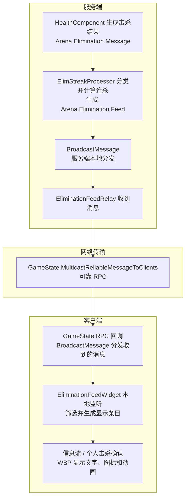

# 一条击杀消息怎样驱动 UI

以“玩家 A 用手雷击杀玩家 B”为例，跟随这次击杀从服务端到客户端 UI 的过程。
服务端负责计算结果，客户端负责显示结果。

**`BroadcastMessage` 只在本端分发消息；RPC 负责跨网络传输。**

## 1. 消息的完整路径



### 第一步：服务端生成结果

`UArenaHealthComponent` 在玩家 B 死亡时生成 `FArenaVerbMessage`，以 `Arena.Elimination.Message` 在服务端分发。
`UElimStreakProcessor` 接收后判定敌杀、友杀或自杀，更新权威计数，再发布 `Arena.Elimination.Feed`。
这条消息携带 A、B 的 PlayerState、击杀分类、计数，以及可选的手雷定义资产引用。

### 第二步：转发器把消息送上网络

服务端的 `UArenaEliminationFeedRelay` 监听 `Arena.Elimination.Feed`，收到后调用
`AArenaGameState::MulticastReliableMessageToClients(Message)`，把同一份消息数据发送到所有客户端。

手雷定义按资产引用传递，不会把整份手雷配置逐字段发送。

### 第三步：客户端把收到的消息交给本地监听者

GameState 的 RPC 客户端回调调用：

```cpp
UGameplayMessageSubsystem::Get(this).BroadcastMessage(Message.Verb, Message);
```

这里沿用 `Arena.Elimination.Feed` 标签和收到的数据。客户端不重新计算击杀或连杀，
只是通知自己的 UI 监听者。网络转发仅由服务端执行，因此客户端这次本地分发不会再次发送 RPC。

### 第四步：UI 将消息变成显示条目

`UArenaEliminationFeedWidget` 接收本地消息，保存姓名、队伍、分类和计数等显示快照，加入列表。
列表行 `UArenaEliminationFeedEntry` 绑定条目后调用 WBP 的展示事件；文字、颜色、图标和动画由 WBP 处理。
控件负责条数上限、到期移除，以及销毁时清理监听和计时器。

同一条客户端消息可以同时驱动两个 UI，不需要再发一次 RPC：

| UI | 收到消息后的处理 |
| --- | --- |
| `W_EliminationFeed` | 显示所有有效击杀 |
| `W_EliminationConfirmation` | 只保留本地玩家造成的击杀，或本地玩家被其他玩家击杀的消息 |

## 2. 连杀播报走同样的网络路径

若本次击杀达到三杀等播报档位，`UElimStreakProcessor` 还会生成一条 `Arena.Accolade.*` 的 `FArenaVerbMessage`。
它通过 `UArenaAccoladeRelay` 和同一个 GameState 可靠 RPC 到达客户端，再由客户端本地分发。

当前播报 UI 多一层本地转换：

**客户端 VerbMessage → AccoladeRelay → NotificationMessage → AccoladeHostWidget → W_AccoladeToast。**

`FArenaNotificationMessage` 用于适配播报 UI：保留播报标签和玩家，发布到本地 `Arena.AddNotification.Message`。
Host 用标签查询 `DT_Accolades`，加载图标和音效、排队，再调用 WBP 展示。
这次转换不产生额外网络传输；killfeed 则直接消费 `FArenaVerbMessage`。

播报队列会跳过查表失败的条目，同类播报只替换同一玩家的条目，控件重建后会忽略旧回调。

## 3. 修改与验证入口

- 消息生成与计数：`Source/Arena/Private/Character/ArenaHealthComponent.cpp`、`Source/Arena/Private/Messages/ElimStreakProcessor.cpp`。
- 网络转发与客户端分发：`Source/Arena/Private/Messages/ArenaEliminationFeedRelay.cpp`、`Source/Arena/Private/Messages/ArenaAccoladeRelay.cpp`、`Source/Arena/Private/GameState/ArenaGameState.cpp`。
- UI 数据处理：`Source/Arena/Private/UI/Widget/ArenaEliminationFeedWidget.cpp`、`Source/Arena/Private/Accolades/ArenaAccoladeHostWidget.cpp`；样式与动画在对应 WBP，播报内容在 `DT_Accolades`。
- 相关回归：`Arena.UI.EliminationFeed`、`Arena.UI.Accolades.QueueAndLifecycle`。自动化覆盖消息分发和生命周期；Steam 多进程联机及视听效果需另外验收。

准星命中/击杀反馈走独立的 `ClientNotifyEnemyHit`，见 [HitFeedback.md](HitFeedback.md)。
