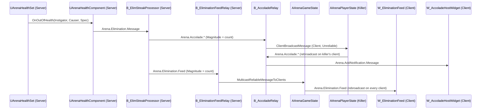

# 击杀通知链路：信息流与中间连杀播报

本文说明一次击杀从服务端判定、经网络分发，到客户端显示右侧击杀信息流（Elimination Feed）
和屏幕中间连杀播报（Accolade）的完整链路。信息流的条目表现、手雷归因与自动化测试细节见
`Docs/EliminationFeed.md`；准星上的命中/击杀反馈是独立链路，见 `Docs/HitFeedback.md`。

## 1. 总览

两条链路共用同一个服务端起点和同一份连杀计数，之后分开：

| | 击杀信息流 | 中间连杀播报 |
| --- | --- | --- |
| 接收者 | 所有客户端 | 仅击杀者本人的客户端 |
| 网络通道 | `AArenaGameState::MulticastReliableMessageToClients`（NetMulticast，Reliable） | `AArenaPlayerState::ClientBroadcastMessage`（Client，Unreliable） |
| 客户端消息 | `Arena.Elimination.Feed`（`FArenaVerbMessage`） | `Arena.Accolade.*` → `Arena.AddNotification.Message`（`FArenaNotificationMessage`） |
| 显示控件 | `W_EliminationFeed`（`UArenaEliminationFeedWidget`） | `W_AccoladeHostWidget`（`UArenaAccoladeHostWidget`） |
| 触发条件 | 每次有效玩家死亡 | 计数命中处理器配置的档位 |

两个 RPC 挂在不同 Actor 上、可靠性不同，客户端上播报与信息流的到达先后不作保证。

## 2. 服务端：击杀判定与原始消息

### 2.1 判定入口

1. 伤害 GE 在服务端执行，`UArenaHealthSet::PostGameplayEffectExecute` 扣血后，若 Health 由正变为不大于 0，
   广播 `OnOutOfHealth(Instigator, Causer, &EffectSpec, ...)`。
2. `UArenaHealthComponent::HandleOutOfHealth` 收到后：
   - 通过 ASC 发送 `GameplayEvent.Death`，驱动死亡技能；
   - 调用 `BroadcastEliminationMessage`，在本地 `UGameplayMessageSubsystem` 上广播 `Arena.Elimination.Message`。

客户端的 `OnRep_Health` 也会广播 `OnOutOfHealth`，但 `EffectSpec` 为空，`HandleOutOfHealth` 因此不会发消息。
击杀消息只在服务端（含监听服务器主机、单机）产生。`bOutOfHealth` 保证死后的追加伤害不会重复产生击杀。

### 2.2 `Arena.Elimination.Message` 的内容

消息类型为 `FArenaVerbMessage`，由 `BroadcastEliminationMessage` 填写：

| 字段 | 值 |
| --- | --- |
| `Verb` | `Arena.Elimination.Message` |
| `Instigator` | 伤害 Instigator（Actor，可能是 Pawn/Controller/PlayerState，也可能为空） |
| `Target` | 被击杀者 Avatar 解析出的 PlayerState |
| `InstigatorTags` / `TargetTags` | 伤害 Spec 捕获的来源/目标标签 |
| `ContextTags` | `Gameplay.Damage.SelfDestruct`（Instigator 与 Target 相同）、`Gameplay.Damage.FromAlly`（同队）或 `Gameplay.Damage.FromEnemy`（异队，以及无法比较队伍的情况） |
| `ContextObject` | 手雷击杀时为 `UArenaGrenadeDefinitionData`，否则为空（见 `Docs/EliminationFeed.md`） |

这是服务端内部消息，不直接复制。计分（`B_ArenaDeathMatchScoring`）等其他系统也监听它。

## 3. 服务端：连杀处理器 `UElimStreakProcessor`

### 3.1 部署

`B_ArenaGameState` 上挂着以下 `UGameplayMessageProcessor` 组件，组件 `BeginPlay` 时调用 `StartListening`，
`EndPlay` 时注销监听：

| 组件 | C++ 父类 | 监听范围 |
| --- | --- | --- |
| `B_ElimStreakProcessor` | `UElimStreakProcessor` | 仅 Authority |
| `B_EliminationFeedRelay` | `UArenaEliminationFeedRelay` | 仅 Authority |
| `B_AccoladeRelay` | `UGameplayMessageProcessor`（逻辑在蓝图） | 服务端与客户端（蓝图内按 `Switch Has Authority` 分支） |
| `B_ArenaDeathMatchScoring` | — | 计分，不在本文范围 |

GameState 是全局单例，处理器只在服务端维护一份数据，不按玩家实例化。

### 3.2 计数规则

`UElimStreakProcessor::OnEliminationMessage` 先把 `Instigator`、`Target` 统一解析为 PlayerState
（`UArenaVerbMessageHelpers::GetPlayerStateFromObject`），再用 `UArenaTeamSubsystem::CompareTeams` 分类。
三份历史以攻击者 PlayerState 为键，保存在处理器的 Transient 成员中：

| 分类 | 条件 | 历史 | 封顶 | 死亡是否清零 |
| --- | --- | --- | --- | --- |
| 自杀 | 攻击者 == 被击杀者 | `PlayerSelfElimHistory` | 10 | 否（本局累计） |
| 敌人击杀 | 攻击者存在、不同人且 `DifferentTeams` | `PlayerEnemyElimHistory` | 6 | 是 |
| 友军击杀 | `OnSameTeam` | `PlayerFriendlyElimHistory` | 30 | 否（本局累计） |

处理顺序：

1. 若存在攻击者，对应历史 +1 并封顶；若新计数在该分类的档位表（`EnemyElimStreakTags`、`SelfElimStreakTags`、
   `FriendlyElimStreakTags`）中，立即广播一条播报消息（见 3.3）。
2. 若存在被击杀者，从敌人连杀历史中移除被击杀者（任何死亡都会清零其敌人连杀，包括自杀）。
3. 按本次分类读出当前计数，复制原消息并改写为 `Arena.Elimination.Feed` 广播（见 3.4）。

边界情况：

- 攻击者为空（环境死亡）：不计数、不播报，信息流计数为 0。
- 被击杀者无法解析为 PlayerState：队伍比较为 `InvalidArgument`，既不计数也不产生信息流消息。
- 任一方没有队伍（`InvalidArgument`）：不计数、不播报；但原始消息已带 `FromEnemy`，信息流仍按敌人击杀显示，计数为 0。

### 3.3 播报消息 `Arena.Accolade.*`

| 字段 | 值 |
| --- | --- |
| `Verb` | 档位表中配置的标签 |
| `Instigator` | 攻击者 PlayerState |
| `InstigatorTags` / `ContextTags` | 复制自原始消息 |
| `Magnitude` | 当前计数 |

`B_ElimStreakProcessor` 当前配置的档位：

| 分类 | 计数 → 标签 |
| --- | --- |
| 敌人 | 2 → `EliminationStreak.2`，3 → `.3`，4 → `.4`，5 → `.5`，6 → `.5+` |
| 自杀 | 1 → `SelfKillStreak.1`，2 → `.2`，3 → `.3` |
| 友军 | 1 → `FriendlyKillStreak.1`，3 → `.3`，5 → `.5`，10 → `.10`，20 → `.20` |

（标签前缀均为 `Arena.Accolade.`。）敌人计数封顶为 6，因此第 6 次及之后每次敌人击杀都会再次触发 `.5+`；
自杀超过 3、友军超过 20 后不再触发。`DefaultGameplayTags.ini` 中的 `FriendlyKillStreak.30` 目前未配置到档位表，
`DT_Accolades` 也没有对应行。

### 3.4 信息流消息 `Arena.Elimination.Feed`

在原始消息基础上改写：

| 字段 | 值 |
| --- | --- |
| `Verb` | `Arena.Elimination.Feed` |
| `Instigator` / `Target` | 改写为 PlayerState（原始 Instigator 可能是客户端无法解析的 Controller 或已销毁的 Pawn） |
| `Magnitude` | 本次分类的当前计数，环境死亡为 0 |
| 其余字段 | 原样保留（含 `ContextTags`、`ContextObject`） |

信息流与播报共用同一份权威计数，客户端不自行累计。

## 4. 网络分发

### 4.1 信息流：GameState 可靠多播

1. `UArenaEliminationFeedRelay` 仅在 Authority 上监听 `Arena.Elimination.Feed`，收到后调用
   `AArenaGameState::MulticastReliableMessageToClients(Message)`。
   重复 `StartListening` 会先注销旧监听。
2. `MulticastReliableMessageToClients_Implementation` 转调 `MulticastMessageToClients_Implementation`，
   只有 `NM_Client` 才在本地 `UGameplayMessageSubsystem` 重新广播同一条消息。
3. 监听服务器主机和单机不经过 RPC 重新广播，主机的信息流直接收到处理器在本地发出的原消息，因此每端每条只显示一次。

`FArenaVerbMessage` 作为 RPC 参数复制时，对象字段按 NetGUID 解析：
`Instigator`、`Target` 是已复制的 PlayerState；`ContextObject` 是手雷定义资产，按路径解析，不依赖已销毁的手雷 Actor。

### 4.2 播报：击杀者 PlayerState 的 Client RPC

`B_AccoladeRelay` 在 `BeginPlay` 以 `PartialMatch` 监听 `Arena.Accolade`，按 `Switch Has Authority` 分两路：

- **Authority**：将消息 `Instigator` 解析为 `AArenaPlayerState`，调用 `ClientBroadcastMessage(Message)`。
  该 RPC 为 `Client, Unreliable`，只发往拥有该 PlayerState 的连接，即击杀者自己的客户端。
  `ClientBroadcastMessage_Implementation` 只在 `NM_Client` 下重新广播 `Arena.Accolade.*`。
- **Remote**（客户端收到上面的重新广播后）：构造 `FArenaNotificationMessage` 并广播到
  `Arena.AddNotification.Message`：`TargetChannel = Arena.Accolade`，`PayloadTag = 播报标签`，`TargetPlayer = 击杀者 PlayerState`。

蓝图中还引用了 `IsDedicatedServer`，用于让非专用服务器（监听服务器主机）在本地生成通知。
具体连线未在编辑器中逐节点核对，修改该蓝图前需在编辑器中确认分支。

由于 RPC 为 Unreliable，丢包时播报可能丢失，这是播报作为纯提示的既定取舍；信息流使用可靠通道，不受影响。

## 5. 客户端显示

两个控件都放在 `WBP_CharacterOverlay` 中。专用服务器不创建 HUD。

### 5.1 击杀信息流

`W_EliminationFeed`（`UArenaEliminationFeedWidget`）在 `NativeConstruct` 中监听 `Arena.Elimination.Feed`（专用服务器不注册），
收到后：

1. 将 `Target` 解析为 PlayerState；无效则丢弃。
2. 新建 `UArenaEliminationFeedItem` 快照：攻击者/被击杀者姓名、队伍 ID（来自 PlayerState）、
   分类（`SelfDestruct` 或攻击者等于被击杀者 → Self；`FromAlly` → Ally；`FromEnemy` → Enemy）、
   计数（`Magnitude` 截到 0～99）、`GrenadeDefinition`、到期时间。攻击者为空时显示本地化的 “Environment”。
3. 追加到 `ToastListWidget`（ListView），超过 `MaxEntries`（默认 8）移除最早一条；
   按最早到期时间调度单个计时器，到期（默认 6 游戏秒）后移除。
4. 列表行 `W_EliminationFeedEntryWidget`（`UArenaEliminationFeedEntry`）在 `NativeOnListItemObjectSet` 中
   按 `MaxNameLength` 裁剪姓名，调用蓝图事件 `PresentElimination`；布局、颜色、图标、动画全部由 WBP 决定。

快照在接收时生成，之后改名、重生、离线都不影响已显示的条目。详细的表现约定见 `Docs/EliminationFeed.md`。

### 5.2 中间连杀播报

`W_AccoladeHostWidget`（`UArenaAccoladeHostWidget`）在 `NativeConstruct` 中监听 `Arena.AddNotification.Message`：

1. **过滤**：只处理 `TargetChannel == Arena.Accolade` 的通知。
   `TargetPlayer` 非空时只检查控件有无 OwningPlayer，不比对是否为本地玩家；“只给击杀者显示”依赖第 4.2 节中 RPC 只发往击杀者连接。
2. **查表**：分配递增的 `SequenceID`，以 `FDataRegistryId("Accolades", PayloadTag)` 异步获取行。
   `AccoladeDataRegistry` 的数据源为 `DT_Accolades`，行名即播报标签全名；
   `DefaultGame.ini` 的 `DataRegistrySettings` 扫描 `/Game/Blueprints/Accolades` 注册该 Registry。
   找不到行时记录 `LogArena` 错误并回收序号。
3. **加载资源**：行结构为 `FArenaAccoladeDefinitionRow`，异步加载其中的 `Sound` 和 `Icon` 软引用。
4. **保序**：`ConsiderLoadedAccolades` 只按 `NextDisplaySequenceID` 顺序取出已加载完成的条目，
   保证显示顺序与接收顺序一致，不受异步加载完成先后影响。
5. **位置过滤与互斥**：只接受 `Row.LocationTag == LocationName` 的条目。
   新条目的 `CancelAccoladesWithTag` 命中队列中条目的 `AccoladeTags` 时，移除旧条目并销毁其控件（例如三杀顶掉双杀）。
6. **逐条显示**：队首条目调用蓝图事件 `CreateAccoladeWidget` 创建 `W_AccoladeToast`，
   并按 `Row.DisplayDuration` 设置计时器；到时 `DestroyAccoladeWidget` 并显示下一条。

`DT_Accolades` 的当前内容：

| 行 | 文案 | 图标（`/Game/UI/Hud/Art/AccoladesTron/`） |
| --- | --- | --- |
| `EliminationStreak.2`～`.5` | Double / Triple / Quadra / Penta Kill | `T_UI_Icon_Accolade_Tron_DoubleKill` 等 |
| `EliminationStreak.5+` | Multi Kill | `T_UI_Icon_Accolade_Tron_MultiKill` |
| `FriendlyKillStreak.1/3/5/10/20` | Killed a teammate … Killed twenty teammates | `T_UI_Icon_Accolade_Tron_FriendlyKill*` |
| `SelfKillStreak.1/2/3` | — | `T_UI_Icon_Accolade_Tron_SelfKill*` |

敌人连杀行引用 `/Game/Audio/ParagonMaleAnnouncer` 下的 DoubleKill、TripleKill、QuadraKill、PentaKill、EpicKillingSpree 语音。
`W_AccoladeHostWidget` 通过 `PlaySoundAfterDelay` 播放音效，`W_AccoladeToast` 显示图标、文案与玩家名并播放 `IntroOutro` 动画。
文案、图标、音效、时长和互斥关系都在 `DT_Accolades` 中维护，C++ 只负责排队与生命周期。

## 6. 维护指引

| 需求 | 修改位置 |
| --- | --- |
| 新增或调整连杀档位 | `B_ElimStreakProcessor` 的三个档位表 + `DefaultGameplayTags.ini` 标签 + `DT_Accolades` 同名行 |
| 播报文案、图标、音效、时长、互斥 | `DT_Accolades` |
| 播报样式与动画 | `W_AccoladeToast`、`W_AccoladeHostWidget` |
| 信息流条数、存活时间 | `W_EliminationFeed` 类默认值（同步调整条目 WBP 的 `IntroWithTimedOutro` 动画） |
| 信息流行样式、图标 | `W_EliminationFeedEntryWidget` |
| 计数封顶或清零规则 | `UElimStreakProcessor::OnEliminationMessage`（信息流计数与播报同时受影响） |
| 新的击杀上下文（如武器） | 在 `BroadcastEliminationMessage` 写入可按路径解析的资产到 `ContextObject`，再由信息流读取 |

注意事项：

- 处理器的 `Arena.Elimination.Feed` 和 `Arena.Accolade.*` 都在服务端本地广播；客户端只能通过第 4 节的 RPC 收到，
  新增客户端监听时不要直接监听 `Arena.Elimination.Message`（客户端上不存在）。
- 通过 RPC 复制的 `FArenaVerbMessage` 中，对象字段必须可网络寻址（已复制的 Actor 或资产），否则客户端得到空指针。
- 连杀历史保存在 GameState 组件中，随 GameState 重建（如回合无缝切换后）而清空。
- `DefaultGameplayTags.ini` 中的 `Arena.AddNotification.Killfeed` 以及旧蓝图结构 `EliminationFeedMessage`、对象 `ElimFeedEntry`
  不再参与运行时链路，保留仅为兼容历史引用。

## 7. 相关源码

| 文件 | 作用 |
| --- | --- |
| `Source/Arena/Private/AbilitySystem/ArenaHealthSet.cpp` | 扣血与 `OnOutOfHealth` |
| `Source/Arena/Private/Character/ArenaHealthComponent.cpp` | 生成 `Arena.Elimination.Message` |
| `Source/Arena/Private/Messages/ElimStreakProcessor.cpp` | 权威计数、播报与信息流消息 |
| `Source/Arena/Private/Messages/ArenaEliminationFeedRelay.cpp` | 信息流服务端转发 |
| `Source/Arena/Private/GameState/ArenaGameState.cpp` | 多播 RPC 与客户端重新广播 |
| `Source/Arena/Private/Player/ArenaPlayerState.cpp` | 播报 Client RPC 与客户端重新广播 |
| `Source/Arena/Private/UI/Widget/ArenaEliminationFeedWidget.cpp` | 信息流快照、列表与到期 |
| `Source/Arena/Private/UI/ArenaEliminationFeedEntry.cpp` | 信息流行绑定与姓名裁剪 |
| `Source/Arena/Private/Accolades/ArenaAccoladeHostWidget.cpp` | 播报查表、保序、互斥与逐条显示 |
| `Source/Arena/Public/Messages/ArenaVerbMessage.h`、`ArenaNotificationMessage.h` | 消息结构 |
