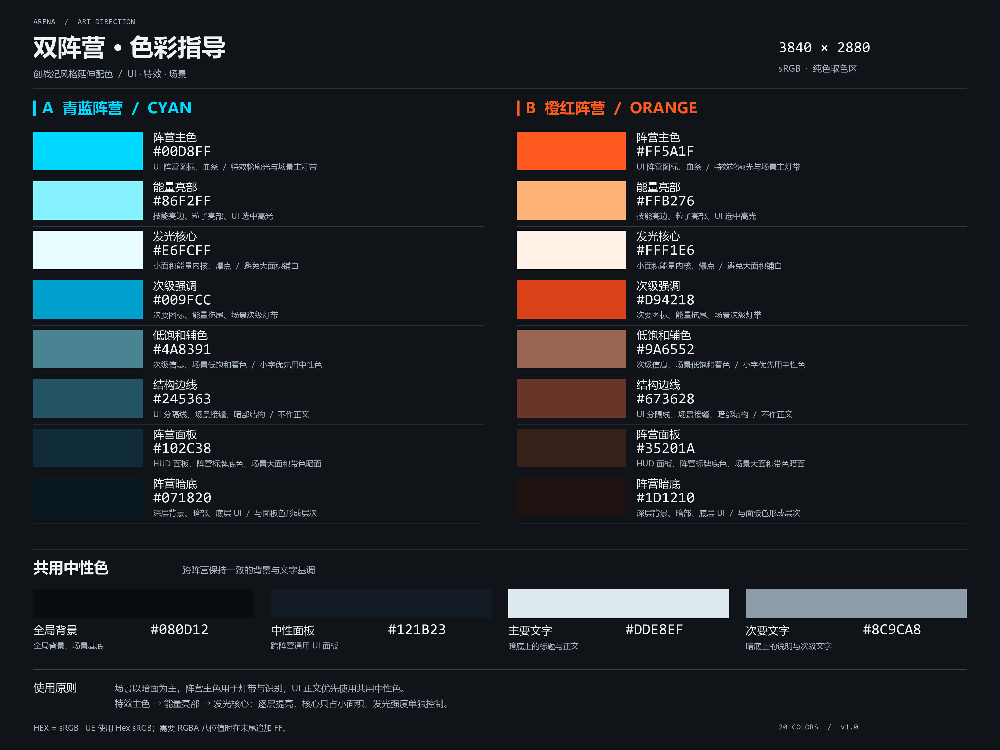

# Arena UI 配色规则

## 1. 强制适用范围

- 所有新增、修改或审查的 UI、Widget Blueprint（WBP）、HUD、UI 材质及其状态表现，必须严格参照本文件与项目色卡，不得自行引入相近色、替代色或新的颜色体系。
- 青蓝与橙红是两个阵营的固定视觉标识。同一阵营在图标、血条、标记、边框和场景关联 UI 中必须保持一致，不得因具体界面或控件而互换颜色。
- 颜色必须按下表的语义用途使用；主色、亮部、边线和暗底不可随意互相替代。既有 UI 在本次开发涉及的范围内也须遵循本规则。
- 配色的样式、视觉参数和动画固化在对应 WBP 或 UI 材质资源中；C++ 仅传递业务逻辑与业务状态，不硬编码视觉颜色或表现控制。

## 2. 项目色卡

- 高清 PNG：[双阵营色彩指导](Docs/Art/FactionColorPalette.png)。
- 尺寸：3840 × 2880；包含两个阵营各 8 色及 4 个共用中性色，内嵌 sRGB 色彩配置。
- 所有 HEX 均为 **sRGB 的 `#RRGGBB`**。下列数值是录入颜色的依据，禁止凭目测调整或从缩放、压缩后的截图中推定颜色。
- 本文件与色卡共同定义项目配色；变更色值、颜色用途或增加颜色时，必须同步维护本文件及色卡，保持一致后再用于 UI。

## 3. 阵营颜色

下列标识用于统一描述颜色用途，不要求以本次规范变更新增业务代码或资产。

| 用途标识 | 颜色名称 | 青蓝阵营 HEX | 橙红阵营 HEX | UI 使用约束 |
| --- | --- | --- | --- | --- |
| `Primary` | 阵营主色 | `#00D8FF` | `#FF5A1F` | 阵营图标、血条、选中标记和主要识别元素的默认颜色 |
| `Highlight` | 能量亮部 | `#86F2FF` | `#FFB276` | 选中高光、技能亮边和局部强调；外围保留主色以维持阵营识别 |
| `Core` | 发光核心 | `#E6FCFF` | `#FFF1E6` | 极小面积的能量内核与爆点；禁止作为大面积阵营底色或主要识别色 |
| `Secondary` | 次级强调 | `#009FCC` | `#D94218` | 次要图标、低于主色一级的强调元素与能量拖尾 |
| `Muted` | 低饱和辅色 | `#4A8391` | `#9A6552` | 低饱和辅助信息与场景关联着色；小号文字优先使用共用文字色 |
| `Edge` | 结构边线 | `#245363` | `#673628` | 面板分隔线、边框与暗部结构；禁止用于小号正文 |
| `Surface` | 阵营面板 | `#102C38` | `#35201A` | HUD 面板、阵营标牌与带阵营倾向的背景面 |
| `Deep` | 阵营暗底 | `#071820` | `#1D1210` | 深层背景、暗部与底层 UI；与 `Surface` 区分层次 |

## 4. 共用中性色

| 用途标识 | 颜色名称 | HEX | 使用约束 |
| --- | --- | --- | --- |
| `Shared.Background` | 全局背景 | `#080D12` | 跨阵营的全局背景与深色基底；也用于明亮主色实心控件上的深色文字 |
| `Shared.Panel` | 中性面板 | `#121B23` | 跨阵营共用的 UI 面板，不随玩家阵营变化 |
| `Shared.Text` | 主要文字 | `#DDE8EF` | 暗底上的标题与正文 |
| `Shared.TextMuted` | 次要文字 | `#8C9CA8` | 暗底上的说明、单位与次级信息 |

## 5. UI 状态与颜色录入

- **默认与选中状态**：阵营身份使用 `Primary`，局部选中高光使用 `Highlight`，次级信息使用 `Secondary` 或共用文字色；禁止对主色任意偏移色相或重新生成明暗变体。
- **正文与对比**：暗色面板上的正文使用共用文字色；明亮主色实心控件上的文字使用 `Shared.Background`。不得将浅色文字直接铺在明亮主色底上，也不得用 `Edge` 或 `Deep` 作为正文色。
- **禁用、淡入淡出与透明度动画**：允许在保持基础 RGB 不变的前提下单独控制 Alpha；禁用状态同时通过图标、文字或交互状态表达，不能只依赖颜色。
- **警告、错误、成功等语义状态**：现有色表未单独定义这些状态的专用色，不得借开发某个控件临时增加颜色，也不得直接将某一阵营色定义为全局错误或成功色。需要新增语义色时，先同步扩展本规则与色卡，再使用。
- **UE 编辑器与蓝图**：在颜色选择器的 **Hex sRGB** 中录入表中数值；若字段要求八位 RGBA，去掉 `#` 并追加 Alpha，例如青蓝主色为 `00D8FFFF`，橙红主色为 `FF5A1FFF`。不透明时 Alpha 为 `FF`；不得把这些 sRGB 值直接填入 **Hex Linear**。
- **线性颜色输入**：蓝图手动构造 Linear Color 或设置线性材质参数时，需要先将 sRGB 转换为线性 RGB；不得直接将 8 位 RGB 除以 255 后当作线性颜色。
- **发光表现**：发光强度与基础色分开控制，参数保存在对应视觉资源中；不能通过无约束加亮使主要阵营识别元素变成近白色。
- **交付检查**：检查默认、选中、悬停、按下、禁用及淡入淡出等实际存在的状态；核对基础色值、阵营一致性和文字可读性。材质输出与透明叠加应在实际 UI 中检查，不能仅凭颜色选择器预览判定效果。
