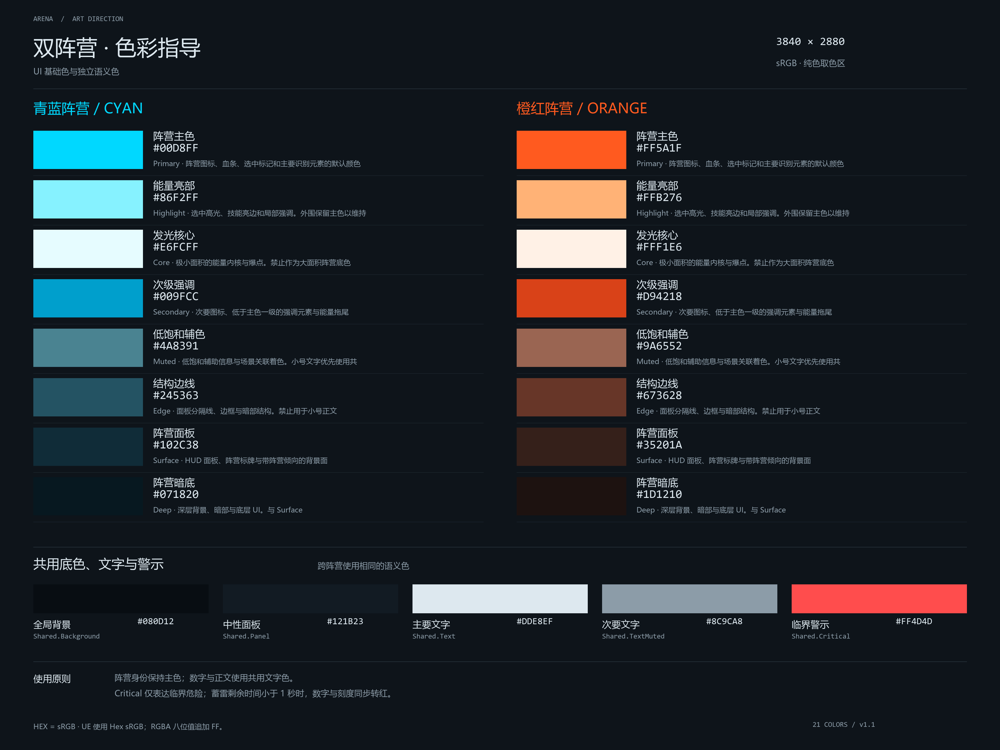

# Arena UI 配色参考

调色板资产保存运行时基础色。下表与 [双阵营色卡](../../../Docs/Art/FactionColorPalette.png) 定义录入值和用途。色卡为内嵌 sRGB 配置的 3840 × 2880 PNG。按表中的 sRGB `#RRGGBB` 录入，禁止从缩放或压缩截图取样。改动时同步维护资产、下表和色卡。

## 阵营颜色

TeamId 1 固定为橙红，TeamId 2 固定为青蓝。图标、血条、标记、边框和场景关联 UI 按实际展示对象的阵营保持一致。

| 用途标识 | 颜色名称 | 青蓝阵营 HEX | 橙红阵营 HEX | UI 使用约束 |
| --- | --- | --- | --- | --- |
| `Primary` | 阵营主色 | `#00D8FF` | `#FF5A1F` | 阵营图标、血条、选中标记和主要识别元素的默认颜色 |
| `Highlight` | 能量亮部 | `#86F2FF` | `#FFB276` | 选中高光、技能亮边和局部强调。外围保留主色以维持阵营识别 |
| `Core` | 发光核心 | `#E6FCFF` | `#FFF1E6` | 极小面积的能量内核与爆点。禁止作为大面积阵营底色或主要识别色 |
| `Secondary` | 次级强调 | `#009FCC` | `#D94218` | 次要图标、低于主色一级的强调元素与能量拖尾 |
| `Muted` | 低饱和辅色 | `#4A8391` | `#9A6552` | 低饱和辅助信息与场景关联着色。小号文字优先使用共用文字色 |
| `Edge` | 结构边线 | `#245363` | `#673628` | 面板分隔线、边框与暗部结构。禁止用于小号正文 |
| `Surface` | 阵营面板 | `#102C38` | `#35201A` | HUD 面板、阵营标牌与带阵营倾向的背景面 |
| `Deep` | 阵营暗底 | `#071820` | `#1D1210` | 深层背景、暗部与底层 UI。与 `Surface` 区分层次 |

## 共用颜色与回退

| 用途标识 | 颜色名称 | HEX | UI 使用约束 |
| --- | --- | --- | --- |
| `Shared.Background` | 全局背景 | `#080D12` | 跨阵营的全局背景与深色基底。也用于明亮主色实心控件上的深色文字 |
| `Shared.Panel` | 中性面板 | `#121B23` | 跨阵营共用的 UI 面板 |
| `Shared.Text` | 主要文字 | `#DDE8EF` | 暗底上的标题与正文 |
| `Shared.TextMuted` | 次要文字 | `#8C9CA8` | 暗底上的说明、单位与次级信息 |
| `Shared.Critical` | 临界警示 | `#FF4D4D` | 与阵营无关的临界危险提示；蓄雷剩余时间小于 1 秒时的数字与刻度 |

| 未分配或不支持的阵营角色 | 库的中性回退 |
| --- | --- |
| `Primary`、`Highlight`、`Core` | `Shared.Text` |
| `Secondary`、`Muted` | `Shared.TextMuted` |
| `Edge`、`Surface` | `Shared.Panel` |
| `Deep` | `Shared.Background` |

## 状态表现与颜色录入

- 默认阵营身份使用 `Primary`，局部选中高光使用 `Highlight`，次级强调使用 `Secondary` 或共用文字色。保留语义对应关系，禁止临时偏移色相或自造明暗变体。
- 暗色面板正文使用共用文字色，明亮主色实心控件上的文字使用 `Shared.Background`。正文避开 `Edge`、`Deep` 和亮底上的浅色文字。
- 禁用和淡入淡出只调整 Alpha，保留基础 RGB。禁用状态同时用图标、文字或交互状态表达。发光强度单独配置，确保主识别元素仍能分辨阵营。
- 临界危险使用 `Shared.Critical`，不改变阵营识别元素的颜色。错误、成功等其他语义状态尚无专用色；需要新增时先扩展调色板、此参考和色卡，禁止把阵营色用作全局错误或成功色。
- 编辑调色板资产时，在 UE 颜色选择器的 **Hex sRGB** 中录入，基础 Alpha 为 1。八位 RGBA 字段去掉 `#` 并追加 `FF`，例如青蓝主色为 `00D8FFFF`，橙红主色为 `FF5A1FFF`。手动构造 Linear Color 时先做 sRGB 到线性 RGB 的转换。库的查询结果已是线性 `FLinearColor`。
- 富文本分段着色时，将查询结果在 WBP 转为 sRGB RGBA 字符串。UI 与世界表现共用材质时分离 UI 参数应用路径，避免影响角色和特效。
